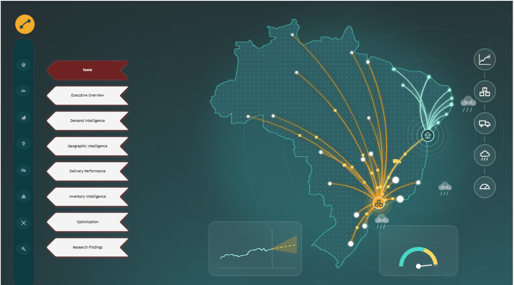
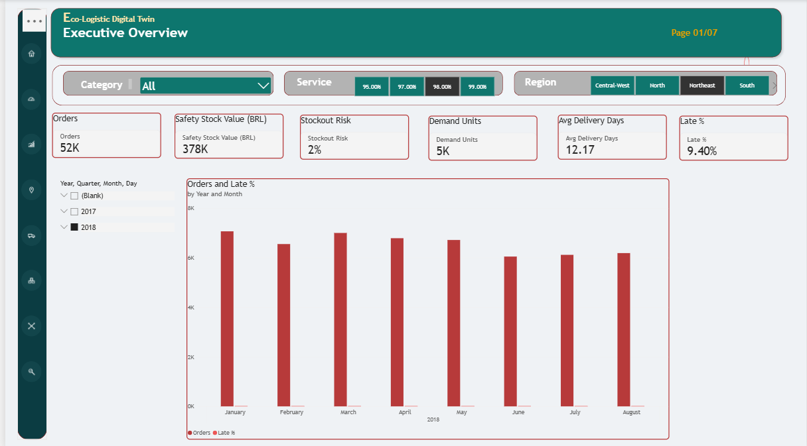
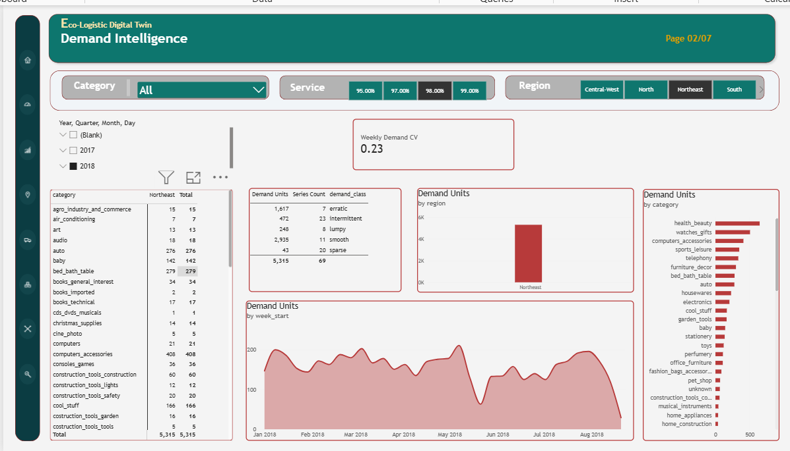
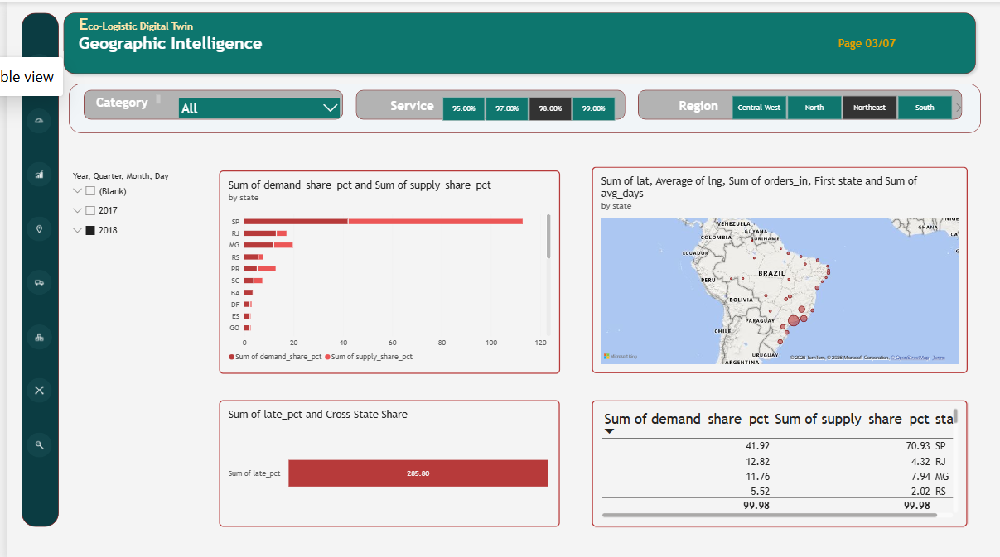
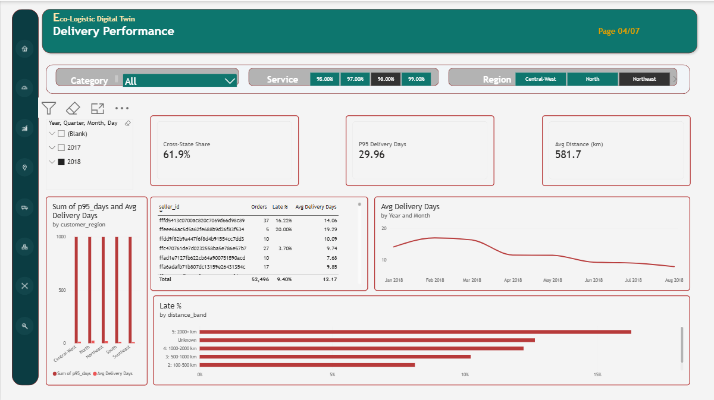
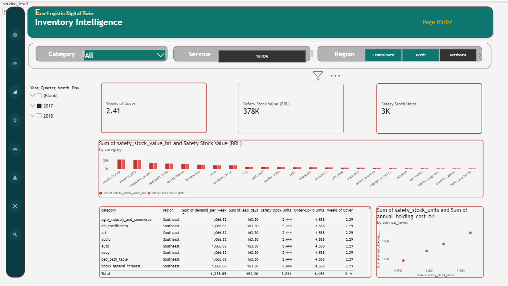
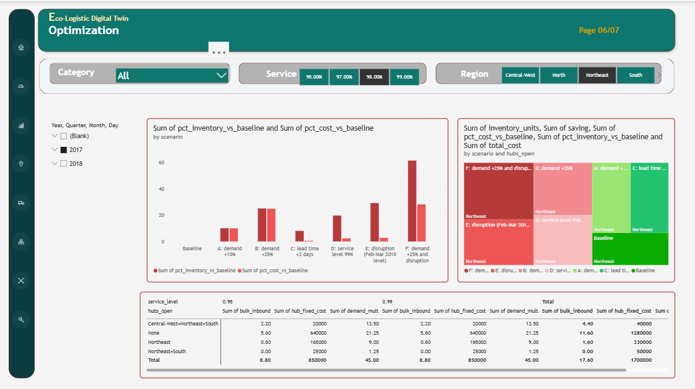
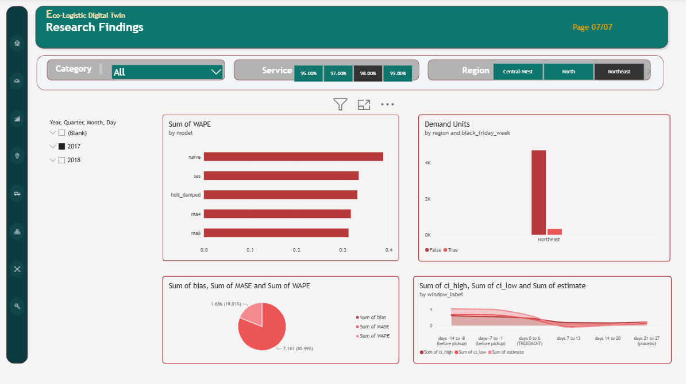

<div align="center">

# 🌿 Eco-Logistics Digital Twin

**Where should inventory sit, how much should we hold, and what happens when conditions change?**

A data-driven model of a Brazilian e-commerce supply chain: demand forecasting, weather impact analysis, inventory policy, hub location, an interactive Power BI report and a Streamlit scenario app.


[GitHub Repository](https://github.com/pranoti711/eco-logistics-digital-twin) • [LinkedIn](https://www.linkedin.com/in/pranoti-munjankar-1760092b9/)



</div>

---

## 📌 Table of Contents

- [Overview](#-overview)
- [Key Findings](#-key-findings)
- [Dashboard Preview](#-dashboard-preview)
- [Streamlit Scenario App](#-streamlit-scenario-app)
- [Project Architecture](#-project-architecture)
- [Methodology](#-methodology)
- [Repository Structure](#-repository-structure)
- [How to Run](#-how-to-run)
- [Limitations](#-limitations)
- [Data Source](#-data-source)
- [Author](#-author)

---

## 🎯 Overview

Online retailers that ship across a large country face three connected decisions: **where to keep stock, how much to keep, and how those choices hold up when demand, costs, weather or service targets change.**

This project builds a "digital twin" of that problem using the public Olist Brazilian e-commerce dataset, enriched with daily weather data. It combines data loading into PostgreSQL, Python forecasting and optimisation, a weather impact analysis, a seven-page Power BI report and a Streamlit app, so a non-technical reader can explore the results.

## 🔑 Key Findings

| Finding | Result |
|---|---|
| Best hub location | A **Northeast hub** saves about **R$20.5k per year** in the baseline scenario |
| Hub viability | Holds up to roughly **R$17.6k to R$30.5k** of annual fixed cost (bulk inbound 10% to 20%); a South hub is not justified |
| Cross-state shipping | **64%** of orders cross state lines |
| Demand vs supply mismatch | Rio de Janeiro: **12.8%** of demand, only **4.3%** of supply |
| Delivery time | Driven mainly by region and distance; P95 delivery ranges from about **25 to 44 days** |
| Forecasting | An **8-week moving average** beat the more complex models, including LightGBM, in the backtest |

## 📊 Dashboard Preview

The Power BI report has a home page plus seven analysis pages. The file is in [`power bi/dashboard.pbix`](power%20bi/dashboard.pbix).

### Executive Overview


### Demand Intelligence


### Geographic Intelligence


### Delivery Performance


### Inventory Intelligence


### Optimization


### Research Findings


## 🖥 Streamlit Scenario App

An interactive app for trying out scenarios without opening Power BI. Run it with `streamlit run streamlit_app/app.py`.


## 🏗 Project Architecture

| Layer | What it does | Where |
|---|---|---|
| Data pipeline | Loads the raw Olist CSV files into PostgreSQL | `python/data_pipeline/load_raw.py` |
| Weather and causal analysis | Fetches daily weather, estimates the effect of rain on delivery, and tests lagged effects | `python/causal/` |
| Forecasting | Weekly demand backtest and a LightGBM comparison | `python/forecasting/` |
| Hub location | Compares candidate hubs on transport and fixed cost | `python/optimization/` |
| Simulation | Core simulation, scenario engine and input export for the report | `python/simulation/` |
| Reporting | Interactive Power BI report with slicers and navigation | `power bi/dashboard.pbix` |
| App | Streamlit scenario app | `streamlit_app/app.py` |

## 🔬 Methodology

- **Data preparation:** raw Olist tables (orders, items, payments, reviews, products, sellers, customers and geolocation) are loaded into PostgreSQL, then aggregated into weekly demand by category and region. Daily weather data is added from an external source.
- **Forecast evaluation:** rolling time-based folds, scored with WAPE, MASE and bias, comparing a moving-average baseline with LightGBM. Backtest folds stop at 2018-08-06.
- **Weather analysis:** estimates how rainfall relates to delivery outcomes, including lagged effects, using fixed effects for state and week. Results are saved in `research/results/`.
- **Inventory policy:** safety stock and order-up-to levels are computed from forecast error and lead time at a selected service level (default 95%).
- **Hub location and scenarios:** candidate hubs are compared on transport cost, fixed cost and service level, then stress-tested across scenarios (service level, demand multiplier, fixed cost, bulk inbound share).

## 📁 Repository Structure

```
eco-logistics-digital-twin/
├── README.md
├── data/
│   ├── external/
│   │   └── weather_daily.csv
│   ├── processed/
│   │   ├── sim_fin.csv
│   │   └── sim_series.csv
│   └── raw/                          # Olist CSV files (not tracked, see Data Source)
├── DOCS/
│   └── images/                       # dashboard screenshots used in this README
├── power bi/
│   └── dashboard.pbix
├── python/
│   ├── causal/
│   │   ├── 01_fetch_weather.py
│   │   ├── 02_rain_effect.py
│   │   └── 03_lead_lag.py
│   ├── data_pipeline/
│   │   └── load_raw.py
│   ├── forecasting/
│   │   ├── 01_backtest.py
│   │   └── 02_lightgbm.py
│   ├── optimization/
│   │   └── 01_hub_location.py
│   └── simulation/
│       ├── core.py
│       ├── engine.py
│       └── export_inputs.py
├── research/
│   └── results/
│       ├── rain_effect_results.csv
│       └── rain_lead_lag.csv
└── streamlit_app/
    └── app.py
```

## ▶️ How to Run

**Requirements:** Python 3.10 or newer, PostgreSQL, and Power BI Desktop (to open the report).

1. Clone the repository and install the Python packages.
   ```bash
   git clone https://github.com/pranoti711/eco-logistics-digital-twin.git
   cd eco-logistics-digital-twin
   pip install -r requirements.txt
   ```
2. Download the Olist dataset from Kaggle and place the CSV files in `data/raw/`.
3. Load the raw data into PostgreSQL.
   ```bash
   python python/data_pipeline/load_raw.py
   ```
4. Run the analysis scripts in this order.
   ```bash
   python python/causal/01_fetch_weather.py
   python python/causal/02_rain_effect.py
   python python/causal/03_lead_lag.py
   python python/forecasting/01_backtest.py
   python python/forecasting/02_lightgbm.py
   python python/optimization/01_hub_location.py
   python python/simulation/export_inputs.py
   ```
5. Launch the scenario app.
   ```bash
   streamlit run streamlit_app/app.py
   ```
6. Open `power bi/dashboard.pbix` in Power BI Desktop and refresh the data source so it points at your database.

## ⚠️ Limitations

- The Olist data covers 2016 to 2018 and thins out at the end of the period, so the final week is incomplete. The baseline demand window is chosen to avoid it.
- The findings come from one public dataset and a simplified cost model. Treat the rupee figures as estimates for comparing options, not as predictions of real savings.
- The weather analysis reports associations and scenario results. It does not prove cause and effect.

## 📚 Data Source

[Olist Brazilian E-Commerce Public Dataset](https://www.kaggle.com/datasets/olistbr/brazilian-ecommerce), released by Olist and published on Kaggle. The raw CSV files are not included in this repository, so please download them from Kaggle. All credit for the raw data goes to Olist.

## 👩‍💻 Author

**Pranoti Munjankar**
B.Tech in Computer Science Engineering | Data and BI Analytics

[](https://www.linkedin.com/in/pranoti-munjankar-1760092b9/)
[](https://github.com/pranoti711)

If you found this project useful, consider giving the repository a ⭐.
